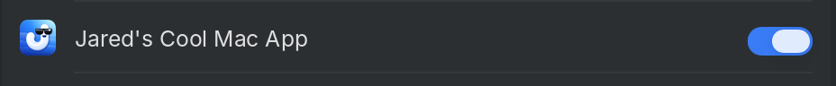
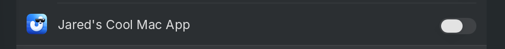
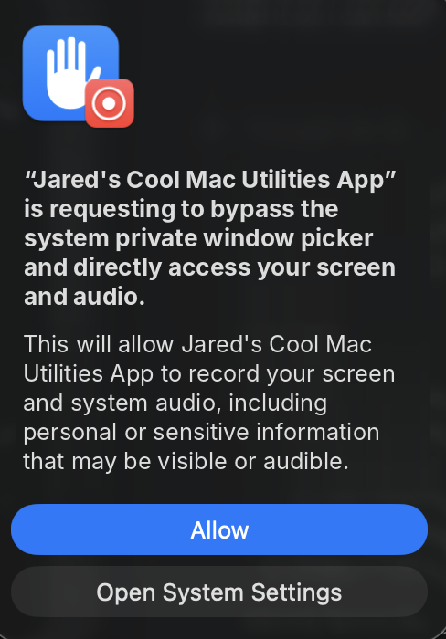
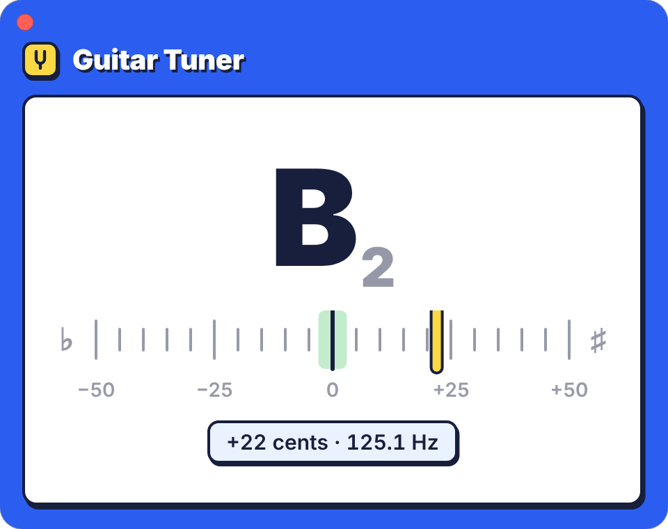

<p align="center"></p>

<h1 align="center">Jared's Cool Mac Utilities App</h1>

<p align="center">A Mac menu bar app with only the features I use.</p>

<p align="center"><a href="https://github.com/jfreema/Jareds-Cool-Mac-Utils-App/raw/main/downloads/jaredsmacutils.pkg"></a></p>

<p align="center">Version 1.1.10 · macOS 14 or later · Apple silicon or Intel</p>

<p align="center"><b>It used to be called Yafie.</b> If updating from Yafie gives you any trouble, <a href="#uninstall">uninstall Yafie</a>, then do a fresh install of Jared's Cool Mac Utilities App.</p>

<table>
  <tr>
    <td width="50%"><b><a href="#app-preview">App preview</a></b><br>Rest the pointer on an app in the Dock to see its windows, and click the one you want.</td>
    <td width="50%"><b><a href="#window-snapping">Window snapping</a></b><br>⌃⌥ and an arrow key put the front window into halves, thirds, quarters or sixths.</td>
  </tr>
  <tr>
    <td width="50%"><b><a href="#screenshot-tool">Screenshot tool</a></b><br>⌃⌥P snips part of the screen to copy, save or mark up, or copies the text in it.</td>
    <td width="50%"><b><a href="#hidden-menu-bar-icons">Hidden menu bar icons</a></b><br>An arrow brings back the menu bar icons that don't fit, as beside the notch.</td>
  </tr>
  <tr>
    <td width="50%"><b><a href="#guitar-tuner">Guitar tuner</a></b><br>Shows the note you're playing and how sharp or flat it is.</td>
    <td width="50%"><b><a href="#drum-machine">Drum machine</a></b><br>Tap a beat on the trackpad, with a metronome and a loop to play along to.</td>
  </tr>
  <tr>
    <td width="50%"><b><a href="#keyboard-cleaning">Keyboard cleaning</a></b><br>Turns off the keyboard and trackpad for a few minutes while you wipe them.</td>
    <td width="50%"><b><a href="#stay-awake-with-the-lid-closed">Stay awake with the lid closed</a></b><br>Keeps a MacBook running with its lid shut, plugged in or on battery.</td>
  </tr>
</table>

## Install

1. Open the **jaredsmacutils.pkg** you downloaded.
2. Click through the installer and enter your password. The app opens, and its icon appears in the menu bar.
3. Click its icon in the menu bar and turn on **Open at Login**.

To update, choose **Check for Updates…** in the app's menu. It installs the newest version and restarts, keeping your settings. Updating to 1.1.6 asks for the app's permissions once more, since it's now signed with an Apple Developer ID; see [troubleshooting](docs/troubleshooting.md#updating-to-116).

---

## App preview

Rest the pointer on an open app's icon in the Dock to see its windows, then click the one you want. With a regular and a private Chrome window open, for example, you go straight to the right one.

**Turn it on:**

1. Click the app's icon in the menu bar and turn on **Show App Previews in the Dock**.
2. When macOS asks, click **Open System Settings**, then turn on **Jared's Cool Mac Utilities App** in the **Accessibility** list, as for [window snapping](#window-snapping).
3. For pictures of the windows, turn on **Jared's Cool Mac Utilities App** in **System Settings → Privacy & Security → Screen & System Audio Recording**, as for the [screenshot tool](#screenshot-tool). Then click **Quit & Reopen**. Without it, the previews show only the windows' titles.

If window snapping and the screenshot tool are already on, the app has both permissions, so step 1 is all it takes.

**Use it:** rest the pointer on an open app's icon in the Dock. Its windows appear above the icon, or beside it with the Dock on the side. Click one to bring it to the front, or click the × in its corner to close that window. Move the pointer away, or click anywhere else, to close the previews.

The previews show the app's windows on the current desktop, oldest first, so each keeps its place. Minimized ones are dimmed.

---

## Window snapping

Hold Control (⌃) and Option (⌥) and press an arrow key to put the front window into halves, thirds, quarters or sixths of its display.

**Turn it on:**

1. Click the app's icon in the menu bar and turn on **Snap Windows with control+option+arrow keys**.
2. When macOS asks, click **Open System Settings**.
3. Turn on **Jared's Cool Mac Utilities App** and enter your password or use Touch ID. The keys work within a couple of seconds.

   | Find the **Accessibility** list | Turn on **Jared's Cool Mac Utilities App** |
   |---|---|
   |  |  |

**Use it:**

- **⌃⌥← and ⌃⌥→** snap the window into the column it's mostly in, then move it a column at a time, across displays.
- **⌃⌥↑** widens it to fill the display. From a third, it goes to two thirds first.
- **⌃⌥↓** moves it clockwise through the display's quarters, or sixths.

Each display has two columns, or three on external displays with **Thirds on External Displays** on.

| ⌃⌥← and ⌃⌥→ | ⌃⌥↓ |
|---|---|
|  |  |

---

## Screenshot tool

Press ⌃⌥P to snip part of the screen, then copy it, save it, mark it up with boxes, lines, arrows, highlights and text, or copy the text in it.

**Turn it on:**

1. Click the app's icon in the menu bar and turn on **Snipping Tool with control+option+P**. Nothing appears yet: macOS just adds the app to its list, switched off.
2. Choose **Allow Screen Snipping…** in the app's menu, then turn on **Jared's Cool Mac Utilities App** and enter your password or use Touch ID.

   | Find the **Screen & System Audio Recording** list | Turn on **Jared's Cool Mac Utilities App** |
   |---|---|
   |  |  |

3. Click **Quit & Reopen**.
4. Take your first snip. macOS asks whether the app can bypass the system private window picker. Click **Allow**, then take the snip again. macOS asks this again about once a month.

   

**Use it:** press ⌃⌥P and drag across part of the screen, as with ⌘⇧4. Press Space to pick a whole window instead, or Esc to cancel. A menu opens where you let go, with **Copy to Clipboard**, **Copy Text**, **Open in Editor** and **Save…**.

**Copy Text** copies the words in the snip as plain text, line by line, even where you can't select them, like an error message, a paused video or a scanned PDF. Your Mac reads them itself, without sending the snip anywhere.

In the editor, drag to draw. Hold Shift to keep lines and arrows to 45° steps, and boxes and highlights square. For text, click where it goes, type, and press Return. **Outline** puts white, red or black around boxes, lines, arrows and text, so they stand out on any snip, and **Size** sets text from 10 to 16 points.

| Keys | What they do |
|---|---|
| R, L, A, H, T | Box, line, arrow, highlight, text |
| 1, 2, 3, 4 | Red, green, blue, yellow |
| W | Thin or thick lines |
| ⌘Z, ⇧⌘Z | Undo, redo |
| ⌘C | Copy it with its shapes. The editor stays open. |
| ⌘S | Save it with its shapes. The editor closes. |
| ⌘Q | Close the editor. The app stays in the menu bar. |

---

## Hidden menu bar icons

When the menu bar is full, macOS hides the icons that don't fit, with no sign they're there. On a MacBook with a notch, icons only go to the right of it, so an app with a long menu bar, like Chrome, can push several off, this app's icon included. An arrow brings them back.

**Turn it on:** click the app's icon in the menu bar and turn on **Arrow to Show Hidden Icons**. A **‹** appears near the right end of the menu bar, where macOS hides icons last. If the app's own icon is one of the hidden ones, bring an app with a short menu bar to the front first, like Finder.

**Use it:** click **‹**. For a moment, the app's name stands in for the other app's menus, so every icon that fits comes back, and the arrow turns to **›**. Click the icon you want. They hide again when you go back to your app, when you click **›** or press a key, or a moment after you're done with them. While they're out, the app has a Dock icon: macOS only gives the menu bar to apps with one.

Hold ⌘ and drag **‹** to move it. The icons to its right are the last ones macOS hides, so drag the ones you always want to see there too, like this app's icon.

---

## Guitar tuner

Shows the note you're playing and how sharp or flat you are, and says **In tune** within 3 cents. Any tuning works, with A4 at 440 Hz.

**Use it:** choose **Guitar Tuner…** in the app's menu, click **Allow** for the microphone the first time, and play a string. The app listens only while the tuner is open, and its menu bar icon turns green, then yellow, orange and red as the sound gets louder.



It uses the input chosen in **System Settings → Sound → Input**, unless that's a Bluetooth or virtual input. Then it uses the Mac's own microphone, since opening a Bluetooth headset's microphone can make it suddenly much louder. On an audio interface, it uses the louder of inputs 1 and 2. It only ever listens and never plays sound.

---

## Drum machine

Tap out a beat on the trackpad, with a metronome, and loop a bar or 4 bars of it to play along to.

**Use it:** choose **Drum Machine…** in the app's menu. The trackpad is the kit: tap its top left for the snare, its top right for the kick, and anywhere along the bottom for a hi-hat. Taps play the drums while the drum machine is the front window and the pointer is over its pads. You can also click the pads.

- **Play** starts the metronome, and **Stop** stops it. Space does both. Set **Tempo** from 40 to 240 beats a minute, or turn **Metronome** off.
- **Record** records what you play for two passes of the **Loop**, a bar or 4 bars, then plays it over and over. The second pass plays back the first while you add to it, so you can play the kick and snare, then the hi-hat, without stopping. From a stop, a bar's count-in comes first. Record again to add more, or **Clear** to start over.
- **Quantize** snaps the loop's hits to the nearest quarter (1/4), eighth (1/8) or sixteenth note (1/16), which starts out chosen. **None** plays them as you played them. Change it any time: the loop keeps every hit as you played it, so all of them move right away.
- **Feel** adds **Light Swing** or **Strong Swing** to alternating eighths or sixteenths. **Laid Back** delays snare backbeats; **Loose Garage** adds repeating pushes and pulls across the drums. **Amount** sets the strength. Change them while the loop plays: your original timing stays saved. **Straight**, or Amount at 0%, uses ordinary quantize; Quantize **None** bypasses Feel. Live taps and the metronome stay unchanged.

Bluetooth headphones play everything a moment late, so you hear each tap after you play it. Wired headphones and the Mac's speakers don't lag. With Bluetooth:

- Turn on **Mute Taps**. Taps light up their pads and record without a sound, so you play along to the metronome and the loop instead.
- Recording allows for the delay your headphones tell macOS about. If the loop still plays your hits late, they lag more than that: while the loop plays, move **Bluetooth Offset** until its hits land on the clicks. It moves every hit played over Bluetooth, and the ones you play later. Set **Quantize** to **None** first to hear them move smoothly.

---

## Keyboard cleaning

Turns off the keyboard and trackpad for 5 minutes, so you can wipe them without typing or clicking anything.

**Turn it on:** it needs the Accessibility permission, as [window snapping](#window-snapping) does. With snapping or app previews on, the app has it already. Otherwise, choose **Clean Keyboard and Trackpad…** in the app's menu, click **Open System Settings** when macOS asks, and turn on **Jared's Cool Mac Utilities App**.

**Use it:** choose **Clean Keyboard and Trackpad…** in the app's menu, then click **Turn Off**. A window in the middle of the screen counts down until they come back on. To turn them back on sooner, hold down both ⌘ keys, left and right, for 1.5 seconds.

Every keyboard, trackpad and mouse is off, external ones too, but not the power button.

---

## Stay awake with the lid closed

Keeps a MacBook awake with its lid closed, plugged in or on battery.

**Turn it on:** click the app's icon in the menu bar, turn on **Stay Awake with Lid Closed**, and enter your password once. The options under it:

- **Plugged In Only** keeps it awake only while it's plugged in. Unplug it and it sleeps as usual, right away if the lid is shut. This one starts out on, so turn it off to stay awake on battery too.
- **Online Only** keeps it awake only while it's online.
- **Low Power Mode** turns on Low Power Mode while the lid is shut, so the Mac runs cooler, if slower. Open the lid and your own setting comes back. It leaves Low Power Mode alone while an external display is in use. This one starts out on.

**While it's on**, the Mac won't sleep even when idle, though the display still turns off. To let it sleep, turn it off. To walk away while it stays awake, press **control+option+L**, which locks the screen as **Lock Screen** in the Apple menu does. On battery, it sleeps as usual once the battery is down to 10%. Don't leave it in a bag while it's awake: with the lid closed, it can get hot, even in Low Power Mode.

Its menu bar icon shows what it's doing:

| Menu bar icon | Meaning |
|---|---|
| Outline | Off, or on but waiting for power or the internet, or the battery is low, so it sleeps as usual |
| Filled in | On, so it stays awake |
| Warning triangle | Needs attention. The menu says what to do. |

<details>
<summary>How it works</summary>

The app turns sleep off with `pmset disablesleep 1` and back on with `pmset disablesleep 0`. If the lid is closed at that point, it also puts the Mac to sleep, unless an external display is in use. The one-time password adds `/etc/sudoers.d/yafie`, which lets your account run only those two commands, and the ones for Low Power Mode, without a password.

Low Power Mode is `pmset lowpowermode`, or `pmset powermode` on Macs that have High Power Mode too. macOS keeps one setting for battery and one for the power adapter. The app only turns on the ones that are off, and puts just those back.

Online means a Wi-Fi, Ethernet or cellular connection (a VPN alone doesn't count) where `captive.apple.com` loads. The app checks once a minute.

If the app quits or crashes, sleep comes back on, and Low Power Mode goes back to your setting, within a second.

</details>

---

## Uninstall

Quit the app, delete `/Applications/jaredsmacutils.app`, or `/Applications/Yafie.app` from before the app was renamed, then run:

```sh
sudo pkgutil --forget io.github.jfreema.yafie
sudo rm -f /etc/sudoers.d/yafie
tccutil reset Microphone io.github.jfreema.yafie
tccutil reset Accessibility io.github.jfreema.yafie
tccutil reset ScreenCapture io.github.jfreema.yafie
```

Having problems? See [Troubleshooting](docs/troubleshooting.md).
